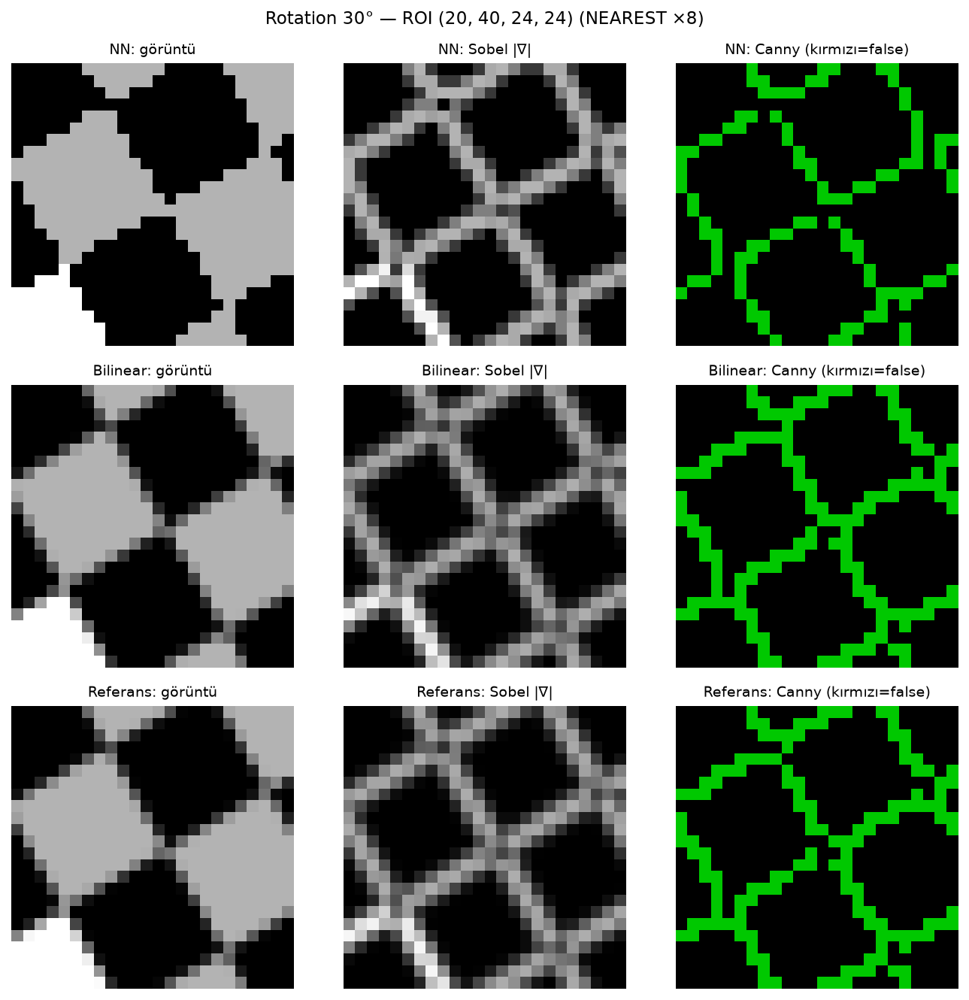

# YZM505 · Görüntü İşleme Take-Home

Kontrast iyileştirme, gürültü filtreleme, geometrik dönüşümler, bilinear resize ve Laplacian keskinleştirme.
Her çekirdek algoritma NumPy ile **elle** yazıldı. Sonra OpenCV / scikit-image karşılıklarıyla piksel piksel
karşılaştırıldı ve her farkın nedeni ölçülerek açıklandı.



<sub>Q2: 30° döndürülmüş dama tahtasında NN interpolasyonunun ürettiği basamaklar, Sobel'de sahte kenar
enerjisine dönüşüyor (NN %10.8, Bilinear %0.6).</sub>

## Sorular ve sonuçlar

| | Konu | Elle yazılan | Öne çıkan sonuç |
|---|---|---|---|
| **Q1** | `pout.tif`, `tire.tif` | Contrast Stretching, Histogram Equalization, Mean / Median / Gaussian | Manuel HE ile `cv2.equalizeHist` arasındaki fark **0**. Doğal gürültüde en iyi denge Gaussian σ=1, salt & pepper'da Median 3×3 (+3.59 dB). |
| **Q2** | `checkerboard.tif` | Inverse mapping ile shear ve rotation, NN ve Bilinear | NN, rotation'da Sobel MAE'yi 3.7'den **52.8**'e çıkarıyor. Canny'de ise kenarın yeri değil, zincirin sürekliliği bozuluyor. |
| **Q3** | `cameraman.tif` | İç içe for döngüleriyle bilinear resize ×1.7 ve Laplacian | `cv2.resize` ile en fazla **±1** fark (PSNR 57.23 dB). Laplacian, `cv2.filter2D` ile **bit düzeyinde aynı**. |

Tüm sayılar `outputs/qN/metrics.json` dosyalarından gelir. Ayrıntılı analiz ve tüm figürler
[`report/report.md`](report/report.md) içinde (Türkçe).

## Neden manuel ve built-in aynı çıkmıyor?

Karşılaştırmada çıkan her fark dört nedenden birine bağlandı:

- **Piksel merkezi kuralı.** OpenCV kaynak konumu `src = (dst + 0.5) · oran − 0.5` ile hesaplar. Naive
  `src = dst · oran` kuralı görüntüyü ≈0.21 piksel kaydırır ve farkı 52 gri seviyeye çıkarır.
- **Sabit nokta aritmetiği.** `cv2.resize`, uint8'de ağırlıkları 11 bitlik tamsayılara yuvarlar. Manuel
  sürüm float64 kullanır. Kalan ±1 fark tek yönlüdür ve bundan kaynaklanır.
- **Border modu.** `np.pad(mode="reflect")`, `BORDER_REFLECT_101` ile aynıdır. `cv2.medianBlur` ise her zaman
  `BORDER_REPLICATE` kullanır. Mod farkı yalnızca görüntünün 1 piksellik çerçevesini etkiler.
- **Veri tipi.** Laplacian uint8'de ya doyar ya da mod 256 sarılır. Bu yüzden tüm ara hesaplar float64'te
  yapılır ve [0, 255] clip yalnızca en sonda uygulanır.

## Çalıştırma

[uv](https://docs.astral.sh/uv/) ve Python 3.13 gerekir.

```bash
uv sync
uv run pytest                          # 111 test
uv run python scripts/q1.py            # q2.py, q3.py → outputs/qN/*.png + metrics.json
uv run python tools/verify_outputs.py  # beklenen çıktılar, değer aralıkları, data/ hash'leri
bash report/build.sh                   # template.md + metrics.json → report.md → report.docx
```

Raporu `.docx` olarak üretmek için `pandoc` kullanılır. pandoc kurulu değilse `python-docx` ile yedek
dönüştürücü devreye girer.

## Yapı

```
src/ip/
  enhance.py     contrast stretch, histogram equalization (LUT)
  filters.py     padding, mean / median / gaussian, laplacian_loops + laplacian_vec
  transforms.py  rotation / shear matrisleri, inverse mapping, NN ve bilinear örnekleme
  resize.py      bilinear_resize_loops + bilinear_resize_vec (half-pixel / naive)
  edges.py       Sobel, Canny, keskinlik ve gürültü metrikleri, gradyan yönü istatistikleri
  metrics.py     max/mean abs diff, PSNR, metrics.json yazımı
  io.py, viz.py  okuma/yazma, figür üretimi
scripts/         q1.py, q2.py, q3.py: her soru için uçtan uca çalıştırma
tools/           çıktı doğrulayıcı, rapor üretici, MATLAB checkerboard üretici
tests/           birim testleri ve küçük sentetik girişlerle elle türetilmiş beklenen değerler
report/          template.md → report.md → report.docx
```

## Kurallar

- Manuel fonksiyonlar çekirdek algoritma için OpenCV veya scikit-image çağırmaz. Built-in sürümler yalnızca
  karşılaştırma için `*_builtin` sarmalayıcılarındadır.
- Rapordaki `bilinear_resize_loops` ve `laplacian_loops` açık iç içe for döngüleri kullanır. Hızlı vektörize
  ikizleri (`*_vec`) testlerde döngü sürümüyle bit düzeyinde eşit olmak zorundadır.
- Her figür bir script tarafından üretilir. Rapordaki her sayı bir `metrics.json` alanından okunur, elle
  yazılmaz.
- `data/` altındaki girişler değiştirilmez. Doğrulayıcı SHA-256 hash'lerini kontrol eder.

## Veri

`pout.tif`, `tire.tif` ve `cameraman.tif`, MATLAB Image Processing Toolbox'ın demo görüntüleridir. MATLAB'da
`checkerboard` bir fonksiyon olduğu ve hazır bir `.tif` dosyası olmadığı için, `checkerboard.tif` aynı
algoritmayla (n = 10, p = q = 4, 80×80) `tools/make_checkerboard.py` tarafından üretilmiştir.
