# YZM505 Vize Ödevi — Rapor

**Ders:** YZM505 Görüntü İşleme · **Öğrenci:** Emre Yılmaz

Bu rapordaki tüm sayılar `outputs/qN/metrics.json` dosyalarından, tüm kod blokları ise `src/ip/` altındaki gerçek kaynak koddan otomatik olarak alınmıştır (`tools/build_report.py`). Tüm figürler script'ler tarafından üretilmiştir; elle alınmış ekran görüntüsü yoktur.

## 0. Ortam, Yeniden Üretilebilirlik ve Varsayımlar

**Ortam:** Python 3.13, NumPy, OpenCV, scikit-image, matplotlib, tifffile (bağımlılıklar `uv.lock` ile sabit).

```bash
uv run pytest                    # birim testleri (manual vs built-in, el hesabı kontrolleri)
uv run python scripts/q1.py      # q2.py, q3.py → outputs/qN/
uv run python tools/verify_outputs.py
bash report/build.sh             # bu rapor (.md + .docx)
```

**Genel kurallar.** "Manual" fonksiyonlar çekirdek algoritma için OpenCV/scikit-image çağırmaz; yalnızca NumPy dizi işlemleri kullanır. Built-in fonksiyonlar yalnızca `*_builtin` adlı karşılaştırma sarmalayıcılarında kullanılır. Tüm hesaplar `float64` ile yapılır; [0, 255] aralığına clip ve `uint8` dönüşümü yalnızca en sonda uygulanır (`np.rint`: .5 değerleri çift sayıya yuvarlanır, OpenCV `saturate_cast` ile aynı davranış).

**Doğrulama yaklaşımı.** Her manual fonksiyon için (i) küçük sentetik dizilerde el ile türetilmiş değerlerle, (ii) aynı border modu kullanılarak OpenCV karşılığıyla karşılaştıran otomatik testler yazılmıştır. Ayrıca beklenen değerleri yalnızca matematiksel tanımlardan türeten ayrı doğrulama testleri yazılmıştır (`tests/test_verifier_q*.py`).

### Varsayımlar (ASSUMPTION)

1. **Q1 — "veya":** Sınav "Contrast Stretching **veya** Histogram Equalization" istemektedir; bu çalışmada **ikisi de** manuel olarak uygulanmış ve karşılaştırılmıştır.
2. **Q1 — gürültü:** "İyileştirme sonrası ortaya çıkan gürültü" ifadesi, kontrast artırmanın görüntüdeki mevcut düşük genlikli gürültüyü büyütmesi olarak yorumlanmıştır; ana analiz bu doğal gürültü üzerindedir. Mean ve Median arasındaki farkı ölçülebilir kılmak için **ek bir deney** olarak HE çıktısına sabit tohumlu (seed = 505) salt & pepper gürültüsü (p = 0.02) eklenmiştir.
3. **Q1 — filtre girişi:** Filtreler hem Contrast Stretching hem HE çıktısına uygulanmıştır; ana görsel anlatım HE üzerindendir (gürültüyü en çok HE büyütür), her iki koldaki tüm sayılar tablolarda verilmiştir.
4. **Q1 — filtre parametreleri:** Mean ve Median için 3×3 ve 5×5; Gaussian için σ = 1 (7×7) ve σ = 2 (13×13), kernel boyutu 2⌈3σ⌉+1.
5. **Q2 — parametreler:** Shear katsayısı sınavda verilmemiştir; yatay shear k = 0.3 seçilmiştir. Canny eşikleri (50, 150) tüm görüntülerde sabittir. Rotation, kırpma olmaması için tuvali büyüten (expand) şekilde ve görüntü merkezi etrafında yapılmıştır; dışarıda kalan bölge 0 (siyah) ile doldurulur.
6. **Q2 — operatörler:** Sobel ve Canny bu soruda dönüşümleri analiz eden araçlardır; OpenCV ile hesaplanmıştır. Geometrik dönüşümler ve her iki interpolasyon manueldir.
7. **Q3 — boyut:** Çıkış boyutu round(1.7·N) olarak alınmıştır (256×256 → 435×435). Koordinat oranı, OpenCV'nin `dsize` verildiğinde kullandığı gibi giriş/çıkış boyutu oranıdır (1/1.7 değil).
8. **Giriş formatı:** `.tif` dosyaları `uint8` değilse [0, 255] aralığına lineer ölçeklenir (ör. MATLAB `checkerboard` görüntüsü `double` tipindedir).
9. **Giriş kaynağı:** `pout.tif`, `tire.tif`, `cameraman.tif` MATLAB Image Processing Toolbox'ın orijinal demo dosyalarıdır. MATLAB'da hazır bir `checkerboard.tif` dosyası yoktur; `checkerboard` bir fonksiyondur. Bu dosya, `I = checkerboard; imwrite(I, 'checkerboard.tif')` ile birebir aynı algoritmayla `tools/make_checkerboard.py` tarafından üretilmiştir. Varsayılan parametreler n = 10 ve p = q = 4'tür; sonuç 80×80 boyutundadır, sağ yarıdaki açık kareler 0.7 gri tonundadır (uint8'de 179). Eğitmenin dosyası farklıysa yalnızca `data/checkerboard.tif` değiştirilip pipeline yeniden çalıştırılır.
10. **Q3 — Laplacian:** Kernel ve keskinleştirme katsayısı sınavda verilmemiştir; 4-komşu kernel [[0, 1, 0], [1, −4, 1], [0, 1, 0]] ve c = 1 seçilmiştir. Laplacian resize edilmiş görüntüye uygulanır.

---

## 1. Soru 1 — Kontrast İyileştirme ve Gürültü Filtreleme

### 1.1 Yöntem: Contrast Stretching

Lineer germe, görüntünün mevcut [r_min, r_max] aralığını [0, 255] aralığına doğrusal olarak eşler:

$$ s = \frac{r - r_{min}}{r_{max} - r_{min}} \cdot 255 $$

Bu dönüşüm, en koyu pikseli 0'a ve en parlak pikseli 255'e götürdüğü için çıktının tam [0, 255] aralığını kullanmasını garanti eder. Gri seviyelerin sıralaması ve seviyeler arası farkların oranları korunur (affine dönüşüm); histogramın **şekli** değişmez, yalnızca genişler.

```python
def contrast_stretch(
    img: np.ndarray, low_pct: float | None = None, high_pct: float | None = None
) -> np.ndarray:
    """Lineer Contrast Stretching (min-max normalizasyonu).

    s = (r - r_min) / (r_max - r_min) · 255
    low_pct/high_pct verilirse r_min/r_max yüzdeliklerden alınır ve dışı clip'lenir
    (uç değerlere dayanıklı varyant). Varsayılan: gerçek min/max → çıktı tam [0,255].
    """
    f = np.asarray(img, dtype=np.float64)
    lo = f.min() if low_pct is None else np.percentile(f, low_pct)
    hi = f.max() if high_pct is None else np.percentile(f, high_pct)
    if hi <= lo:  # sabit görüntü: germe tanımsız
        return np.zeros_like(f)
    return np.clip((f - lo) / (hi - lo) * 255.0, 0.0, 255.0)
```

### 1.2 Yöntem: Histogram Equalization

Histogram Equalization, gri seviyeleri kümülatif dağılım fonksiyonuna (CDF) göre yeniden eşler. N piksel sayısı, h[k] histogram olmak üzere:

$$ CDF(k) = \sum_{j \le k} h[j], \qquad T(k) = \mathrm{round}\!\left(\frac{CDF(k) - CDF_{min}}{N - CDF_{min}} \cdot 255\right) $$

CDF_min, görüntüdeki en koyu mevcut seviyenin CDF değeridir; bu sayede en koyu seviye 0'a, en parlak seviye 255'e gider. Histogram NumPy `bincount` ile, CDF `cumsum` ile hesaplanır; dönüşüm 256 elemanlı bir tablo (LUT) ile dizi indekslemesi şeklinde uygulanır. Burada yuvarlama `floor(x + 0.5)` (yarımlar yukarı) şeklindedir.

```python
def equalization_lut(img_u8: np.ndarray) -> np.ndarray:
    """Histogram Equalization dönüşüm tablosu (LUT), float64, 256 eleman.

    CDF(k) = Σ_{j≤k} h[j];  T(k) = round( (CDF(k) - CDF_min) / (N - CDF_min) · 255 )
    CDF_min: ilk sıfır olmayan kutunun CDF'i → en koyu mevcut seviye 0'a, en parlak 255'e gider.
    """
    h = histogram(img_u8)
    cdf = np.cumsum(h).astype(np.float64)
    n = cdf[-1]
    cdf_min = cdf[np.flatnonzero(h)[0]]
    if n == cdf_min:  # tek seviyeli görüntü
        return np.arange(256, dtype=np.float64)
    lut = np.floor((cdf - cdf_min) / (n - cdf_min) * 255.0 + 0.5)
    return np.clip(lut, 0.0, 255.0)
```

```python
def hist_equalize(img_u8: np.ndarray) -> np.ndarray:
    """Manuel Histogram Equalization: s = T(r) (LUT ile dizi indeksleme). float64 döner."""
    img_u8 = np.asarray(img_u8, dtype=np.uint8)
    return equalization_lut(img_u8)[img_u8]
```

### 1.3 Sonuçlar: pout.tif

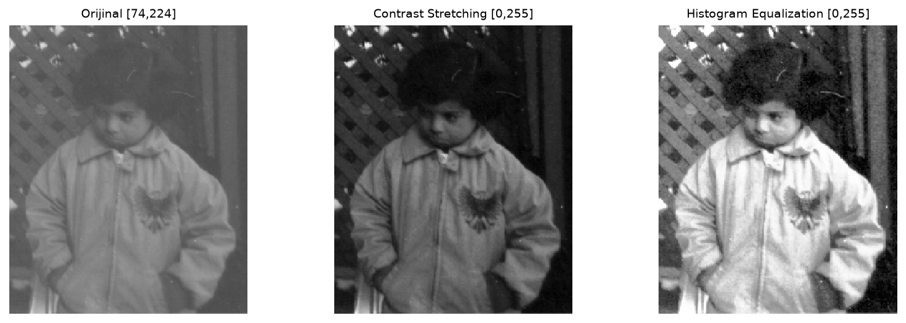

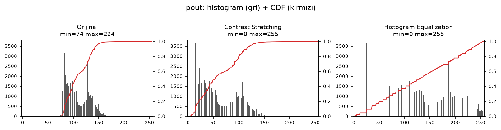

| Görüntü | min | max | ortalama | std | seviye sayısı | CDF lineerlik sapması |
| --- | --- | --- | --- | --- | --- | --- |
| Orijinal | 74 | 224 | 110.3 | 23.2 | 121 | 0.381 |
| Contrast Stretching | 0 | 255 | 61.7 | 39.4 | 121 | 0.466 |
| Hist. Equalization | 0 | 255 | 130.4 | 72.7 | 66 | 0.002 |

Orijinal pout görüntüsü yalnızca [74, 224] aralığını kullanmaktadır. Her iki yöntem de çıktıyı tam [0, 255] aralığına yaymıştır. Contrast Stretching histogramın şeklini koruyarak yalnızca genişletir (seviye sayısı: 121); HE ise CDF'i doğrusallaştırır. Normalize CDF'in ideal lineer CDF'ten (k/255) maksimum sapması orijinalde 0.381, HE sonrası 0.002 olarak ölçülmüştür.

**Built-in karşılaştırma.** Manuel HE ile `cv2.equalizeHist` çıktıları **birebir aynıdır** (maksimum fark 0); iki uygulama aynı formülü kullanır. `skimage.exposure.equalize_hist` ile karşılaştırmada (skimage'ın [0, 1] float çıktısı ×255 ile ölçeklenip yuvarlanmıştır) fark: maksimum 1, ortalama 0.03. scikit-image CDF_min'i çıkarmaz ve histogramı bin merkezleri üzerinden enterpole eder; yani formül tanımı farklıdır.

### 1.4 Sonuçlar: tire.tif

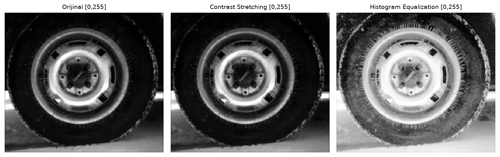

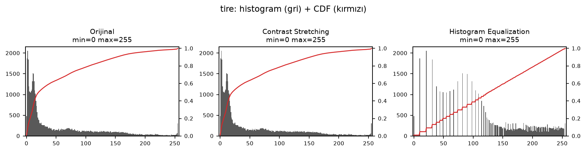

| Görüntü | min | max | ortalama | std | seviye sayısı | CDF lineerlik sapması |
| --- | --- | --- | --- | --- | --- | --- |
| Orijinal | 0 | 255 | 53.7 | 62.2 | 256 | 0.446 |
| Contrast Stretching | 0 | 255 | 53.7 | 62.2 | 256 | 0.446 |
| Hist. Equalization | 0 | 255 | 128.2 | 72.8 | 142 | 0.010 |

Orijinal tire görüntüsü [0, 255] aralığında ve ortalaması 53.7 olan karanlık bir görüntüdür. HE sonrası ortalama 128.2 olmuş, CDF sapması 0.446 → 0.010 olarak ölçülmüştür. Manuel HE ile `cv2.equalizeHist` çıktıları **birebir aynıdır** (maksimum fark 0); iki uygulama aynı formülü kullanır. **Not:** Orijinal tire zaten tam [0, 255] aralığını kullandığı için min-max Contrast Stretching formülü s = (r − 0)/(255 − 0)·255 = r olur, yani görüntüyü **değiştirmez** (figürdeki ilk iki panel özdeştir). Bu görüntüde kontrastı anlamlı biçimde artıran dönüşüm HE'dir. Uç piksellere dayanıklı yüzdelik varyant (`contrast_stretch(low_pct, high_pct)`) uygulanabilir, ancak sınav lineer germe istediği için ana analizde kullanılmamıştır.

### 1.5 Filtreler: Mean, Median ve Gaussian

Üç filtre de NumPy ile manuel olarak yazılmıştır (pencereler `sliding_window_view` ile oluşturulur). **Border (padding) modları:** Mean ve Gaussian için `reflect101` (…c b | a b c | b a…, OpenCV varsayılanı `BORDER_REFLECT_101`), Median için `replicate` (…a a | a b c | c c…, `cv2.medianBlur`'un sabit kullandığı mod). HE görüntüleri üzerinde manuel filtrelerin OpenCV karşılıklarından (aynı border) maksimum farkı — pout: en fazla 1, tire: en fazla 1 gri seviye (ayrıntı: `metrics.json → builtin_check`). Olası ±1 farklar OpenCV'nin `uint8` için sabit noktalı aritmetiğinden kaynaklanan yuvarlamadır (birim testleri: `tests/test_filters.py::test_*_vs_builtin`).

```python
def mean_filter(img: np.ndarray, k: int = 3, border: str = "reflect101") -> np.ndarray:
    """k×k kutu (box/mean) filtresi."""
    return _windows(img, k, border).mean(axis=(-2, -1))
```

```python
def median_filter(img: np.ndarray, k: int = 3, border: str = "replicate") -> np.ndarray:
    """k×k median filtresi. Varsayılan border 'replicate' (cv2.medianBlur ile aynı)."""
    return np.median(_windows(img, k, border), axis=(-2, -1))
```

```python
def gaussian_kernel(sigma: float, ksize: int | None = None) -> np.ndarray:
    """Normalize edilmiş 2B Gaussian kernel: G(x,y) ∝ exp(-(x²+y²)/(2σ²))."""
    if sigma <= 0:
        raise ValueError("sigma > 0 olmalı")
    ksize = ksize or gaussian_ksize(sigma)
    r = ksize // 2
    x = np.arange(-r, r + 1, dtype=np.float64)
    g = np.exp(-(x**2) / (2.0 * sigma**2))
    g /= g.sum()
    return np.outer(g, g)
```

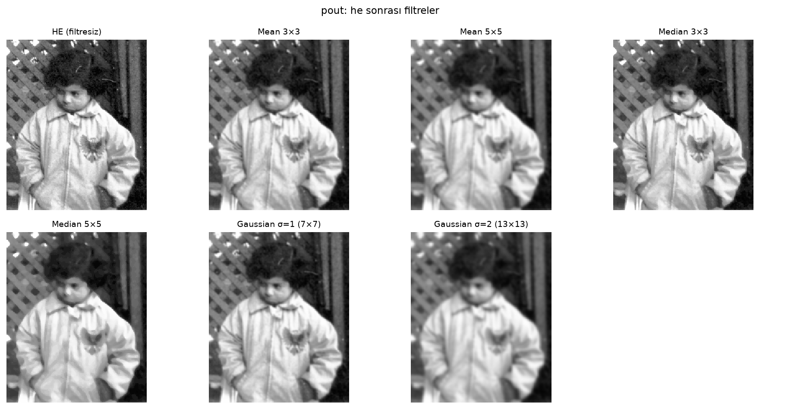

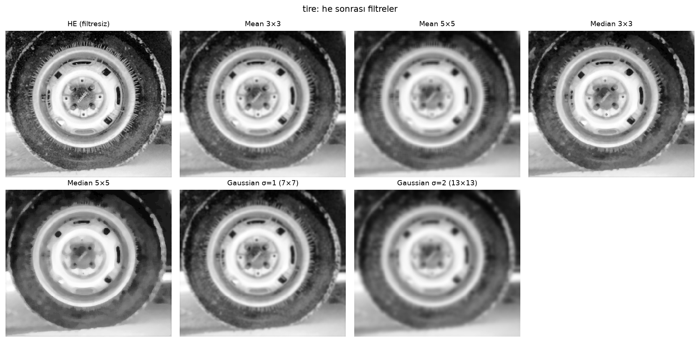

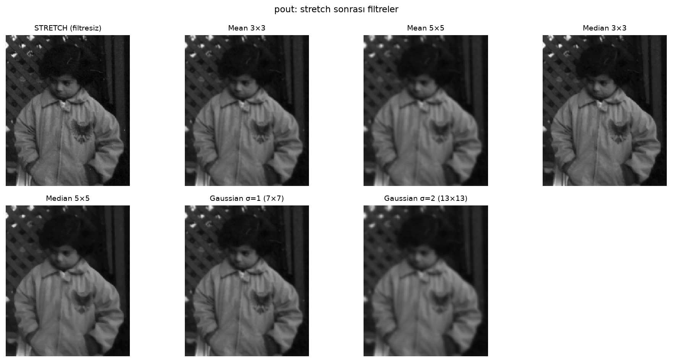

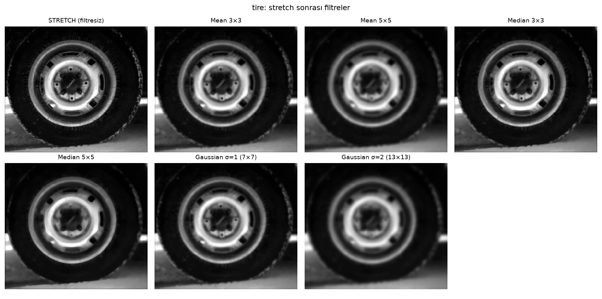

### 1.6 Seçilen Keskinlik Metriği

> **Benim seçtiğim metrik (edge sharpness):** Nesne kenar maskesi içindeki **ortalama Sobel gradyan büyüklüğü**. Maske, filtrelenmemiş iyileştirilmiş görüntünün Gaussian σ = 2 ile yumuşatılmış kopyasında Canny (50, 150) ile bulunan kenarların 3×3 genişletilmesiyle elde edilir ve **tüm filtreler için aynıdır**. Yumuşatma yalnızca maskeyi bulmak içindir (aksi halde HE'nin büyüttüğü gürültü de "kenar" sayılır); metrik her filtrenin kendi ham çıktısı üzerinde ölçülür.
>
> **Gürültü göstergesi:** Düz bölgelerde (yumuşatılmış görüntüde Sobel büyüklüğü alt %40 ve kenarlardan en az 3 piksel uzak) Laplacian yanıtının standart sapması. Laplacian lineer gölgelemeyi yok saydığı için bu değer yüksek frekanslı gürültüyü ölçer.
>
> **Denge skoru:** Keskinlik korunumu S (%) ve gürültü azalması N (%) için 2·S·N/(S+N) (F1 benzeri harmonik ortalama). İkincil olarak Var(Laplacian) da raporlanmıştır.

**pout — HE sonrası** (kenar maskesi 8912 piksel, düz bölge 25903 piksel):

| Filtre | Kenar keskinliği | Korunum % | Düz bölge gürültüsü | Gürültü azalması % | Var(Laplacian) | Denge skoru |
| --- | --- | --- | --- | --- | --- | --- |
| Filtresiz | 193.2 | 100.0 | 23.81 | 0.0 | 719 | — |
| Mean 3×3 | 167.7 | 86.8 | 6.13 | 74.3 | 81 | 80.0 |
| Mean 5×5 | 135.3 | 70.0 | 3.35 | 85.9 | 25 | 77.2 |
| Median 3×3 | 179.2 | 92.7 | 12.81 | 46.2 | 360 | 61.7 |
| Median 5×5 | 160.0 | 82.8 | 9.32 | 60.9 | 238 | 70.2 |
| Gaussian σ=1 | 160.0 | 82.8 | 4.92 | 79.3 | 57 | 81.0 |
| Gaussian σ=2 | 113.2 | 58.6 | 2.20 | 90.8 | 11 | 71.2 |

**tire — HE sonrası** (kenar maskesi 9829 piksel, düz bölge 16731 piksel):

| Filtre | Kenar keskinliği | Korunum % | Düz bölge gürültüsü | Gürültü azalması % | Var(Laplacian) | Denge skoru |
| --- | --- | --- | --- | --- | --- | --- |
| Filtresiz | 213.5 | 100.0 | 29.36 | 0.0 | 1982 | — |
| Mean 3×3 | 176.5 | 82.7 | 7.01 | 76.1 | 157 | 79.3 |
| Mean 5×5 | 140.0 | 65.6 | 3.75 | 87.2 | 42 | 74.9 |
| Median 3×3 | 188.0 | 88.0 | 13.47 | 54.1 | 680 | 67.0 |
| Median 5×5 | 163.9 | 76.7 | 9.04 | 69.2 | 372 | 72.8 |
| Gaussian σ=1 | 167.7 | 78.5 | 5.43 | 81.5 | 106 | 80.0 |
| Gaussian σ=2 | 117.0 | 54.8 | 2.03 | 93.1 | 14 | 69.0 |

**pout — Contrast Stretching sonrası:**

| Filtre | Kenar keskinliği | Korunum % | Düz bölge gürültüsü | Gürültü azalması % | Var(Laplacian) | Denge skoru |
| --- | --- | --- | --- | --- | --- | --- |
| Filtresiz | 214.8 | 100.0 | 9.64 | 0.0 | 183 | — |
| Mean 3×3 | 186.2 | 86.7 | 2.96 | 69.2 | 31 | 77.0 |
| Mean 5×5 | 147.6 | 68.7 | 1.93 | 79.9 | 10 | 73.9 |
| Median 3×3 | 199.9 | 93.0 | 5.34 | 44.6 | 106 | 60.3 |
| Median 5×5 | 176.6 | 82.2 | 3.79 | 60.7 | 70 | 69.8 |
| Gaussian σ=1 | 177.0 | 82.4 | 2.52 | 73.9 | 23 | 77.9 |
| Gaussian σ=2 | 122.0 | 56.8 | 1.57 | 83.7 | 5 | 67.7 |

**tire — Contrast Stretching sonrası:**

| Filtre | Kenar keskinliği | Korunum % | Düz bölge gürültüsü | Gürültü azalması % | Var(Laplacian) | Denge skoru |
| --- | --- | --- | --- | --- | --- | --- |
| Filtresiz | 212.8 | 100.0 | 14.16 | 0.0 | 653 | — |
| Mean 3×3 | 187.1 | 87.9 | 3.47 | 75.5 | 91 | 81.2 |
| Mean 5×5 | 154.5 | 72.6 | 2.10 | 85.2 | 29 | 78.4 |
| Median 3×3 | 201.1 | 94.5 | 9.27 | 34.5 | 394 | 50.6 |
| Median 5×5 | 185.4 | 87.1 | 7.75 | 45.2 | 263 | 59.6 |
| Gaussian σ=1 | 179.5 | 84.4 | 2.69 | 81.0 | 67 | 82.6 |
| Gaussian σ=2 | 131.6 | 61.9 | 1.42 | 89.9 | 13 | 73.3 |

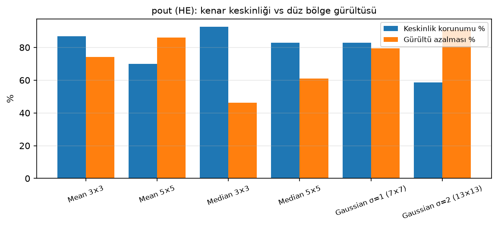

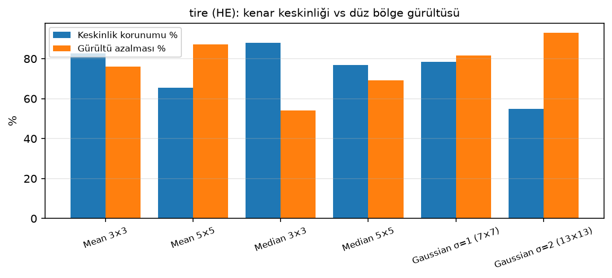

### 1.7 Mean ve Median: Nesne Kenarlarında Karşılaştırma

Aşağıdaki zoom görüntüleri, HE görüntüsünde nesne kenar yoğunluğunun en yüksek olduğu 40×40 pencereden (otomatik ve deterministik seçim; pout için ROI (y, x, h, w) = (97, 113, 40, 40), tire için (22, 121, 40, 40)) alınmış ve piksel yapısı görünsün diye NEAREST ile ×6 büyütülmüştür.

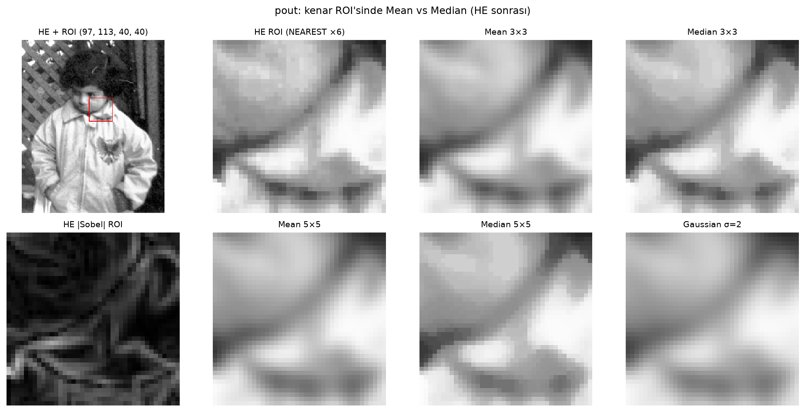

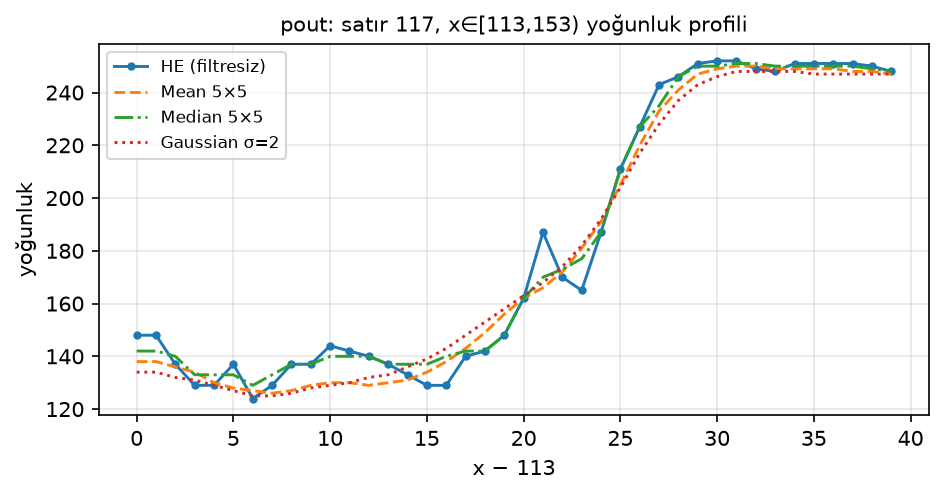

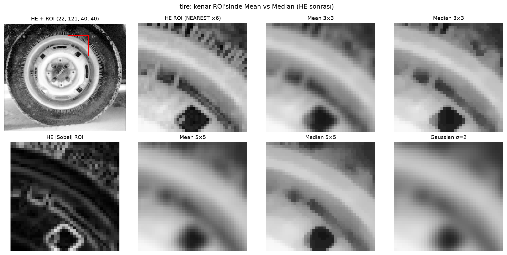

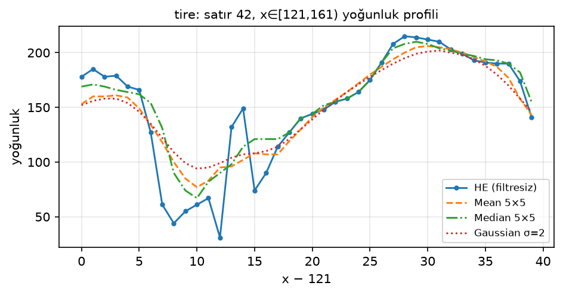

**Neden farklı davranıyorlar?** Mean filtresi bir lineer alçak geçiren filtredir: kenarın iki yanındaki koyu ve açık pikselleri **ortalar**, dolayısıyla basamak şeklindeki kenar k piksel genişliğinde bir rampaya dönüşür (profilde eğimin yayılması). Median filtresi ise lineer değildir: pencere bir kenarı kestiğinde çoğunluk tarafın değerini **seçer**, ara değer üretmez; bu nedenle basamak kenarlar korunur ve tekil (impulsif) aykırı değerler tamamen elenir.

Sayısal olarak, 3×3 pencerede keskinlik korunumu pout için Mean %86.8 / Median %92.7, tire için Mean %82.7 / Median %88.0; 5×5 pencerede pout için Mean %70.0 / Median %82.8, tire için Mean %65.6 / Median %76.7 olarak ölçülmüştür.

Düz bölge gürültü azalması (Mean / Median): pout 3×3 %74.3 / %46.2, pout 5×5 %85.9 / %60.9, tire 3×3 %76.1 / %54.1, tire 5×5 %87.2 / %69.2.

### 1.8 Ek Deney: Salt & Pepper Gürültüsü

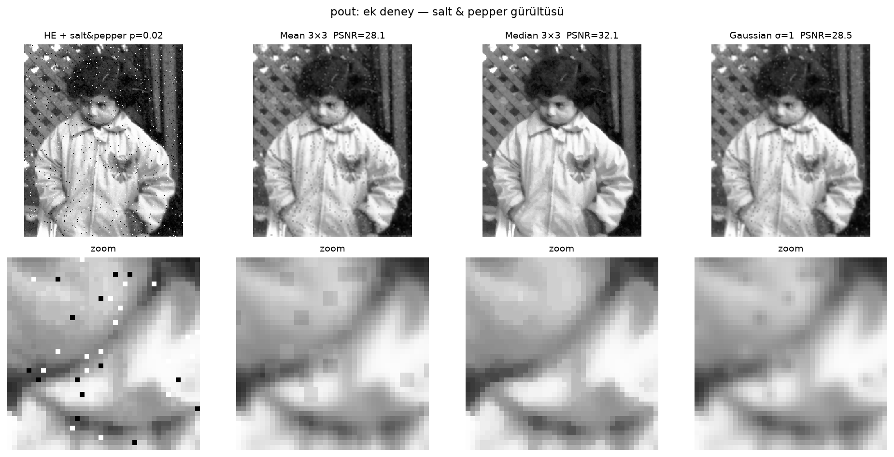

| Görüntü | PSNR (dB, temiz HE'ye göre) | Kenar keskinliği |
| --- | --- | --- |
| Gürültülü (filtresiz) | 21.94 | 207.3 |
| Mean 3×3 | 28.11 | 167.7 |
| Mean 5×5 | 26.54 | 133.6 |
| Median 3×3 | 32.07 | 179.3 |
| Median 5×5 | 28.40 | 160.1 |
| Gaussian σ=1 | 28.47 | 159.3 |
| Gaussian σ=2 | 25.46 | 111.3 |
| Temiz HE (referans) | ∞ | 193.2 |

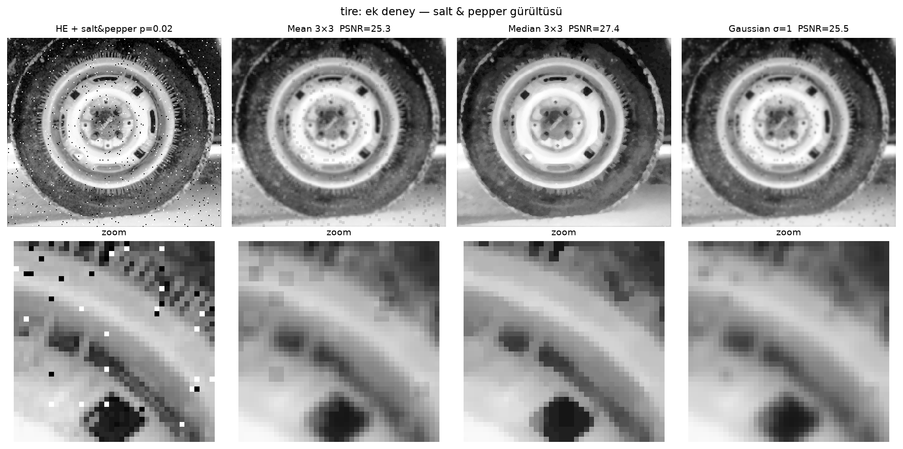

| Görüntü | PSNR (dB, temiz HE'ye göre) | Kenar keskinliği |
| --- | --- | --- |
| Gürültülü (filtresiz) | 21.80 | 226.0 |
| Mean 3×3 | 25.32 | 175.8 |
| Mean 5×5 | 23.19 | 137.9 |
| Median 3×3 | 27.44 | 188.4 |
| Median 5×5 | 24.34 | 163.9 |
| Gaussian σ=1 | 25.52 | 166.4 |
| Gaussian σ=2 | 22.61 | 114.8 |
| Temiz HE (referans) | ∞ | 213.5 |

İmpulsif gürültüde en yüksek PSNR — pout: **Median 3×3** (ikinci Gaussian σ=1 (7×7), fark 3.59 dB); tire: **Median 3×3** (ikinci Gaussian σ=1 (7×7), fark 1.92 dB). Mean ve Gaussian filtreler 0/255 değerli aykırı pikselleri komşularına yayarak gri lekeler bırakır (zoom panelleri); Median ise bu pikselleri sıralamada uçlara attığı için, pencerede çoğunlukta olmadıkları sürece çıktıya taşımaz.

### 1.9 Cevap: Hangi filtre gürültüyü temizlerken keskinliği daha iyi korudu?

Aşağıdaki değerlendirme Bölüm 1.6 tablolarındaki ve Bölüm 1.7–1.8'deki sayılardan otomatik türetilmiştir:

Her iki görüntüde ve her iki pencere boyutunda (3×3, 5×5) **Median, Mean'e göre nesne kenarlarını daha iyi korumuştur** (Bölüm 1.7 sayıları, zoom ve profil figürleri).

Buna karşılık düz bölgelerdeki ince taneli gürültüyü Mean daha güçlü bastırmıştır; Mean'in bu avantajı kenar bulanıklığı pahasına gelmektedir.

Yalnızca kenar keskinliği ölçütünde en iyi filtre her iki görüntüde **Median 3×3** olmuştur.

Ancak yalnız keskinlik ölçütü, en az yumuşatan filtreyi kendiliğinden ödüllendirir (filtresiz görüntü en keskin olandır). Sorunun ölçütü gürültü azaltma ile keskinlik korunumunun **birlikte** değerlendirilmesidir; bu yüzden asıl karar denge skoruna dayanır:

- pout görüntüsü (HE, doğal gürültü): Gaussian σ=1 81.0, Mean 3×3 80.0, Mean 5×5 77.2 … (Median 3×3: 61.7)

- tire görüntüsü (HE, doğal gürültü): Gaussian σ=1 80.0, Mean 3×3 79.3, Mean 5×5 74.9 … (Median 3×3: 67.0)

**Cevap:** Sonuç gürültü türüne bağlıdır. İyileştirmenin büyüttüğü doğal, ince taneli gürültüde (sınavın asıl senaryosu, ASSUMPTION 2) gürültüyü temizlerken keskinliği en iyi dengeleyen filtre her iki görüntüde **Gaussian σ=1 (7×7)** olmuştur. İmpulsif (salt & pepper) gürültüde en iyi filtre her iki görüntüde **Median 3×3** olmuştur (ikinciye göre +3.59 / +1.92 dB). Mean ile Median karşılaştırmasında kenarı daha iyi koruyan filtre Mediandir.

Gaussian filtrede σ büyüdükçe gürültü azalması artar, kenar keskinliği ise düşer (pout keskinlik korunumu: σ=1 → %82.8, σ=2 → %58.6; tire: σ=1 → %78.5, σ=2 → %54.8).

---

## 2. Soru 2 — Geometrik Dönüşümler ve Kenar Belirleme

**Giriş:** `checkerboard.tif`, boyut 80×80.

### 2.1 Yöntem: Inverse Mapping ile Affine Dönüşüm

Bir affine dönüşüm, giriş koordinatını (x, y) çıkış koordinatına (x', y') eşleyen 2×3'lük A matrisiyle tanımlanır. **Forward mapping** (her giriş pikselini hedefe göndermek) çıkışta boşluklar (holes) ve çakışmalar üretir. Bu nedenle **inverse mapping** kullanılmıştır: her çıkış pikseli için A⁻¹ ile girişteki (genellikle tamsayı olmayan) kaynak konum hesaplanır ve o konumdaki değer interpolasyonla bulunur. Böylece her çıkış pikseli tam bir kez doldurulur.

- **Rotation (θ = 30°, merkez etrafında):** $x' = \cos\theta\,(x - c_x) + \sin\theta\,(y - c_y) + c'_x$, $y' = -\sin\theta\,(x - c_x) + \cos\theta\,(y - c_y) + c'_y$. Rotation matrisi: [[0.8660, 0.5000, 0.0420], [-0.5000, 0.8660, 39.5420]], çıkış boyutu 109×109.
- **Shear (yatay, k = 0.3):** $x' = x + k\,y,\; y' = y$. Matris: [[1.0000, 0.3000, 0.0000], [0.0000, 1.0000, 0.0000]], çıkış boyutu 80×104.

```python
def rotation_matrix(deg: float, shape: tuple[int, int], expand: bool = True):
    """Merkez etrafında `deg` derece döndürme (pozitif = ekranda saat yönünün tersi, cv2 kuralı).

    expand=True: çıkış tuvali döndürülmüş görüntünün tamamını içerecek şekilde büyütülür.
    Dönüş: (A 2×3, out_shape).
    """
    h, w = shape
    t = math.radians(deg)
    a, b = math.cos(t), math.sin(t)
    lin = np.array([[a, b], [-b, a]])
    if expand:
        w_out = int(round(w * abs(a) + h * abs(b)))
        h_out = int(round(w * abs(b) + h * abs(a)))
    else:
        h_out, w_out = h, w
    c_in = np.array([(w - 1) / 2.0, (h - 1) / 2.0])
    c_out = np.array([(w_out - 1) / 2.0, (h_out - 1) / 2.0])
    return np.hstack([lin, (c_out - lin @ c_in)[:, None]]), (h_out, w_out)
```

```python
def source_coords(A: np.ndarray, out_shape: tuple[int, int], offset: tuple[float, float] = (0, 0)):
    """Her çıkış pikseli (+alt-piksel offset) için giriş koordinatları (sx, sy) — inverse mapping."""
    lin_inv, t_inv = _inverse(A)
    yy, xx = np.mgrid[0 : out_shape[0], 0 : out_shape[1]].astype(np.float64)
    xx += offset[0]
    yy += offset[1]
    sx = lin_inv[0, 0] * xx + lin_inv[0, 1] * yy + t_inv[0]
    sy = lin_inv[1, 0] * xx + lin_inv[1, 1] * yy + t_inv[1]
    return sx, sy
```

**Nearest Neighbor** kaynak konuma en yakın piksel merkezini alır (yuvarlama); **Bilinear** dört komşunun alan ağırlıklı ortalamasını alır. Görüntü dışına düşen komşular 0 kabul edilir (`BORDER_CONSTANT`).

```python
def _sample_nearest(img: np.ndarray, sx: np.ndarray, sy: np.ndarray, fill: float) -> np.ndarray:
    h, w = img.shape
    xi = np.floor(sx + 0.5).astype(np.intp)  # en yakın piksel merkezi
    yi = np.floor(sy + 0.5).astype(np.intp)
    valid = (xi >= 0) & (xi < w) & (yi >= 0) & (yi < h)
    out = np.full(sx.shape, fill, dtype=np.float64)
    out[valid] = img[yi[valid], xi[valid]]
    return out
```

```python
def _sample_bilinear(img: np.ndarray, sx: np.ndarray, sy: np.ndarray, fill: float) -> np.ndarray:
    """4 komşu ağırlıklı ortalama; görüntü dışındaki komşular `fill` sayılır (BORDER_CONSTANT)."""
    h, w = img.shape
    p = np.pad(img, 1, mode="constant", constant_values=fill)  # p[y+1, x+1] = img[y, x]
    x0 = np.floor(sx)
    y0 = np.floor(sy)
    dx = sx - x0
    dy = sy - y0
    valid = (x0 >= -1) & (x0 <= w - 1) & (y0 >= -1) & (y0 <= h - 1)
    x0i = np.where(valid, x0, -1).astype(np.intp) + 1
    y0i = np.where(valid, y0, -1).astype(np.intp) + 1
    x1i = np.minimum(x0i + 1, w + 1)
    y1i = np.minimum(y0i + 1, h + 1)
    out = (
        (1 - dx) * (1 - dy) * p[y0i, x0i]
        + dx * (1 - dy) * p[y0i, x1i]
        + (1 - dx) * dy * p[y1i, x0i]
        + dx * dy * p[y1i, x1i]
    )
    return np.where(valid, out, fill)
```

**Aliasing'siz referans:** NN ve Bilinear sonuçlarını nesnel olarak değerlendirmek için her çıkış pikselinde 8×8 = 64 alt-piksel konumunda örnekleme yapılıp ortalaması alınan (supersampling, box filtre) bir referans dönüşüm üretilmiştir. Bu, parça parça sabit checkerboard'un ideal alan-ortalamalı dönüşümüne çok yakındır.

**Built-in kontrol:** Manuel dönüşümler `cv2.warpAffine` ile karşılaştırılmıştır. Bilinear'daki küçük farklar, OpenCV'nin alt-piksel konumunu 1/32'ye nicelemesinden (INTER_TAB_SIZE = 32) ve sabit noktalı ağırlıklarından kaynaklanır.

| Görüntü | H | W | max abs Δ (cv2) | ortalama abs Δ | farklı piksel % |
| --- | --- | --- | --- | --- | --- |
| Orijinal | 80 | 80 | 0 | 0.000 | 0.00 |
| Shear (NN) | 80 | 104 | 255 | 0.031 | 0.01 |
| Shear (Bilinear) | 80 | 104 | 1 | 0.010 | 1.00 |
| Rotation 30° (NN) | 109 | 109 | 255 | 0.103 | 0.05 |
| Rotation 30° (Bilinear) | 109 | 109 | 1 | 0.000 | 0.04 |

NN satırındaki maksimum fark (255) piksellerin yalnızca %0.05 kadarında görülür: kaynak konumu iki piksel merkezinin ortasına (.5) çok yakın düşen noktalarda manuel `floor(x+0.5)` ile OpenCV'nin sabit noktalı yuvarlaması farklı komşuyu seçer; checkerboard'da komşular 0 ve 255 olabildiği için tek bir farklı seçim büyük fark üretir.

**Kenar operatörleri ve metrik kodu** (Sobel ve Canny OpenCV ile; gradyan yönü analizi):

```python
def sobel(img: np.ndarray) -> tuple[np.ndarray, np.ndarray]:
    """Sobel gx, gy (ksize=3, float64, BORDER_REFLECT_101)."""
    import cv2

    f = np.asarray(img, dtype=np.float64)
    gx = cv2.Sobel(f, cv2.CV_64F, 1, 0, ksize=3, borderType=cv2.BORDER_REFLECT_101)
    gy = cv2.Sobel(f, cv2.CV_64F, 0, 1, ksize=3, borderType=cv2.BORDER_REFLECT_101)
    return gx, gy
```

```python
def canny(img_u8: np.ndarray, lo: int = CANNY_LO, hi: int = CANNY_HI) -> np.ndarray:
    """cv2.Canny (L1 gradyan, aperture 3). Çıktı bool."""
    import cv2

    return cv2.Canny(img_u8, lo, hi) > 0
```

```python
def orientation_stats(
    img: np.ndarray, expected_deg: tuple[float, ...], mag_pct: float = 90.0
) -> dict:
    """Güçlü gradyanlı piksellerde (mag ≥ pct yüzdelik) gradyan yönünün beklenen yönlerden sapması.

    Yön 180° periyotlu ele alınır. Dönen değerler: ortalama mutlak sapma (°), ±10°'nin dışındaki
    güçlü piksellerin yüzdesi (yanlış yönlü / "basamak" kenar bileşenleri).
    """
    gx, gy = sobel(img)
    mag = np.hypot(gx, gy)
    strong = mag >= np.percentile(mag[mag > 0], mag_pct) if np.any(mag > 0) else mag > 0
    ang = np.degrees(np.arctan2(gy[strong], gx[strong])) % 180.0
    exp = np.array(expected_deg, dtype=np.float64) % 180.0
    d = np.abs(ang[:, None] - exp[None, :])
    d = np.minimum(d, 180.0 - d).min(axis=1)
    return {
        "n_strong": int(strong.sum()),
        "mean_abs_dev_deg": float(d.mean()),
        "pct_off_axis_gt10deg": float(np.mean(d > 10.0) * 100.0),
    }
```

### 2.2 Dönüşüm Sonuçları

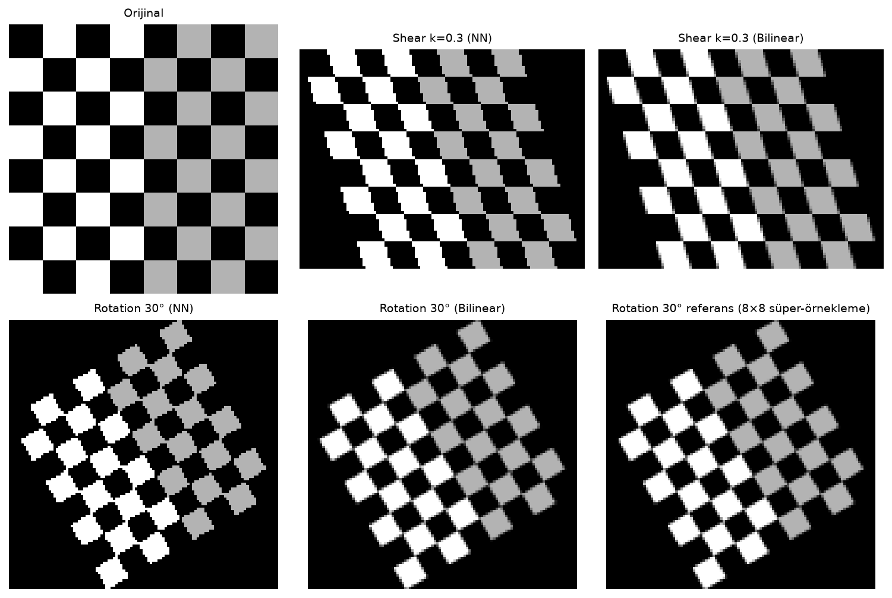

### 2.3 Sobel ve Canny

Sobel (3×3, büyüklük $\sqrt{G_x^2 + G_y^2}$, tüm panellerde ortak ölçek) ve Canny (50, 150) orijinal ve tüm bozulmuş görüntülere uygulanmıştır:

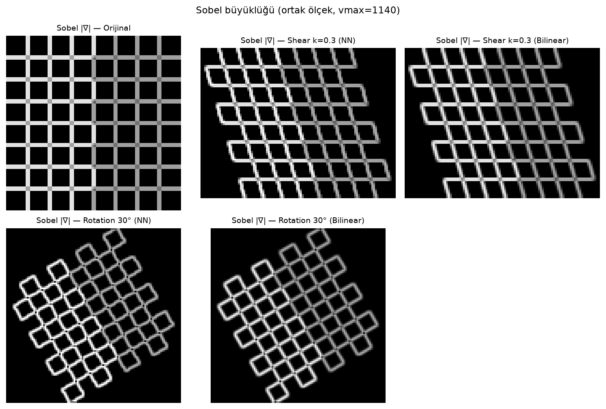

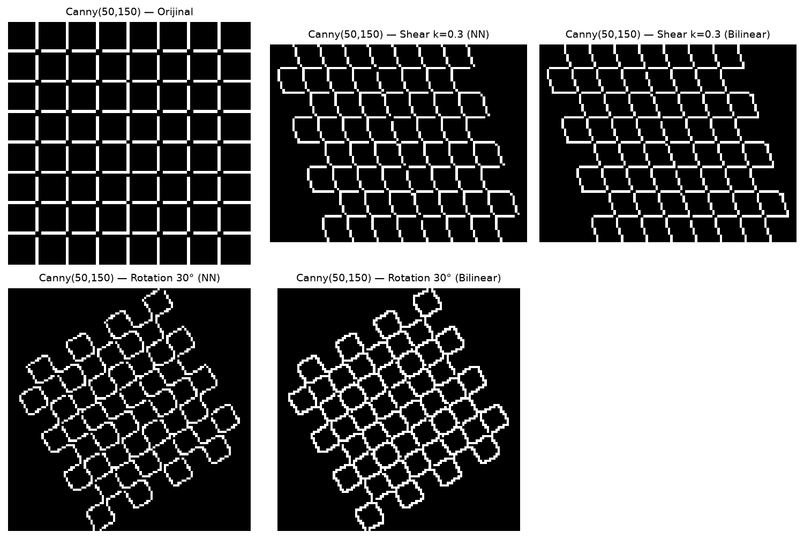

### 2.4 NN ve Bilinear: Kenarların Karşılaştırılması

Metrikler, görüntünün tuval sınırından (görüntü/arka plan kenarı) 3 piksel içeride kalan bölgede ve aliasing'siz referansa göre hesaplanmıştır:

| Görüntü | Sobel MAE (ref.) | Sobel fazla enerji % | Yön sapması (°) | Yön >10° % | Canny piksel / ref. | Canny konum uyumsuzluğu % | Kaçırılan ref. kenar % (1px) |
| --- | --- | --- | --- | --- | --- | --- | --- |
| Orijinal | 0.0 | 0.0 | 0.0 | 0.0 | 931 / 931 | 0.0 | 0.0 |
| Shear (NN) | 28.8 | 6.2 | 7.3 | 29.3 | 912 / 921 | 23.4 | 0.0 |
| Shear (Bilinear) | 1.0 | 0.2 | 2.1 | 8.2 | 917 / 921 | 5.3 | 0.0 |
| Rotation 30° (NN) | 52.8 | 10.8 | 6.3 | 9.5 | 923 / 1198 | 2.3 | 0.0 |
| Rotation 30° (Bilinear) | 3.7 | 0.6 | 3.3 | 5.2 | 1219 / 1198 | 2.0 | 0.0 |

- **Sobel MAE (ref.):** Sobel büyüklüğünün referansın Sobel büyüklüğünden ortalama mutlak farkı. Rotation'da NN 52.8, Bilinear 3.7.
- **Sobel fazla enerji %:** Referansta bulunmayan **fazla** Sobel yanıtının (max(|∇I| − |∇I_ref|, 0)) referans enerjisine oranı; doğrudan "false edge" enerjisinin ölçüsüdür. Rotation'da NN %10.8, Bilinear %0.6.
- **Yön sapması:** Güçlü gradyanlı piksellerde Sobel gradyan yönünün beklenen yönlerden (rotation için 150° ve 60°) ortalama açısal sapması. Rotation'da NN 6.3°, Bilinear 3.3°.

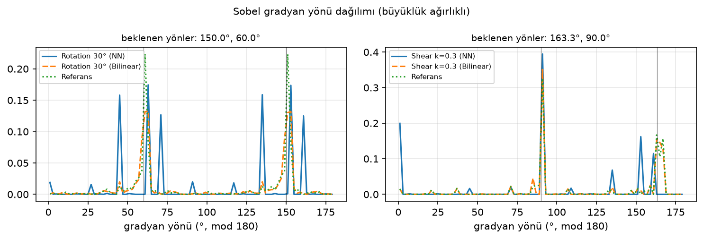

### 2.5 NN Aliasing'in Sobel'de Oluşturduğu Hatalı Kenarlar (Zoom)

Aşağıdaki kırpmalar **sabit ROI koordinatlarıyla** programatik olarak alınmış ve piksellerin görünür kalması için NEAREST ile ×8 büyütülmüştür. Her figürde satırlar NN / Bilinear / Referans, sütunlar görüntü / Sobel / Canny'dir. Canny panelinde yeşil = referansla uyumlu kenar, kırmızı = referanstan 1 pikselden uzak (false) kenar, mavi = kaçırılan referans kenarıdır. Bu veride 1 piksel toleransla false edge oranı NN için %0.0 olduğundan kırmızı piksel görünmez: aliasing Canny'de kenarın **konumunu** değil, zincirin **sürekliliğini ve sayısını** etkiler (rot30 kenar piksel sayısı: NN 923, Bilinear 1219, referans 1198). Sahte kenar etkisi esas olarak Sobel'de görülür.

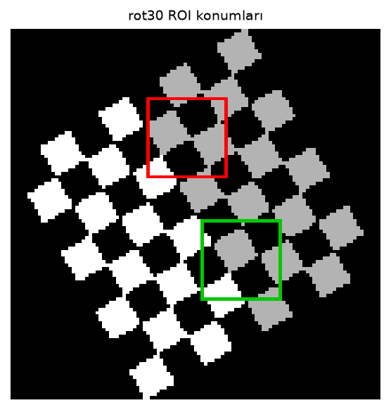

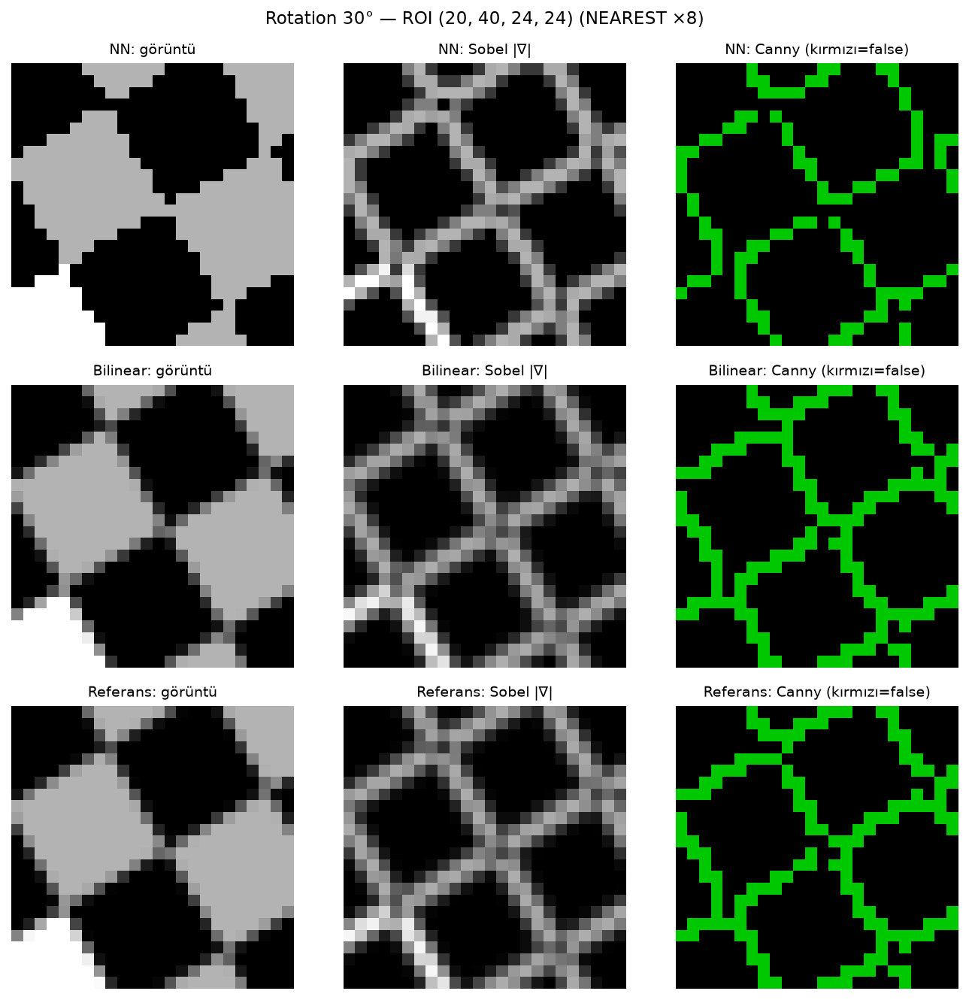

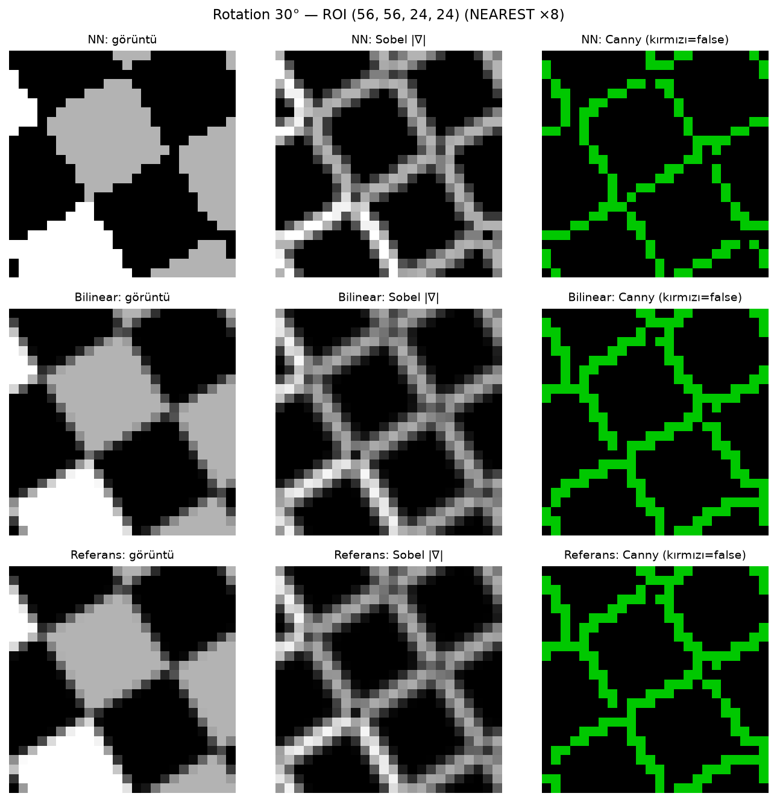

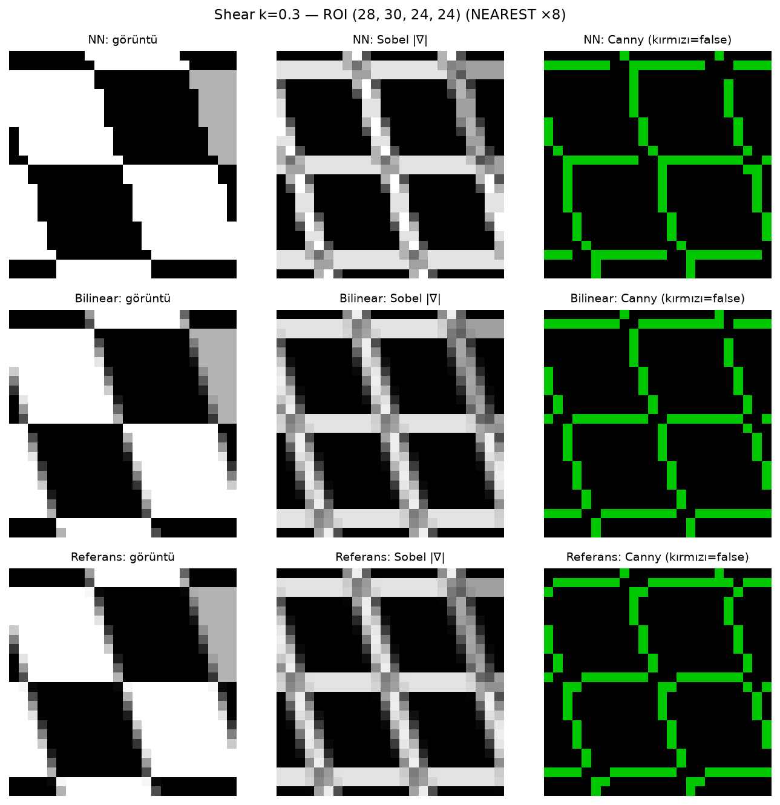

**Açıklama.** NN interpolasyonu her çıkış pikseline en yakın kaynak pikselin değerini kopyalar ve ara değer üretmez. 30° eğik bir karo kenarı bu nedenle yatay ve dikey basamaklardan oluşan bir merdiven (staircase / jaggies) şeklinde örneklenir: kenar boyunca birkaç piksel yatay ilerler, sonra 1 piksel dikey zıplar. Sobel operatörü yerel türev aldığı için bu basamakların **her birini ayrı bir yatay veya dikey mini kenar** olarak algılar:

1. Gradyan yönü, gerçek kenarın normali olan 150° / 60° çevresinde tek tepe yerine ayrık yan tepelere bölünür; basamaklı sınır gerçek eğimin iki yanındaki açılarda gradyan üretir (yön histogramındaki NN eğrisi; shear NN'de ayrıca 0°'de bir tepe oluşur; beklenen yönden 10°'den fazla sapan güçlü piksel oranı: NN %9.5, Bilinear %5.2).
2. Kenar şiddeti basamak köşelerinde tam kontrastla sıçrar, basamakların ortasında ise farklı davranır; Sobel çıktısı düzgün bir çizgi yerine kesikli ve kalınlığı değişen bir desen gösterir. Bu, gerçek sahnede bulunmayan **hatalı (false) kenar** enerjisidir (fazla enerji: NN %10.8, Bilinear %0.6).
3. Canny, inceltme (non-maximum suppression) ve histerezis sonrası bu basamakları takip eder; zoom panellerinde NN Canny zincirinin eğik çizgi yerine basamaklı ilerlediği görülür. Canny tarafında piksel konum uyumsuzluğu NN %2.3, Bilinear %2.0; kenar piksel sayısı NN 923, Bilinear 1219, referans 1198 (kaçırılan referans kenar oranı NN %0.0, Bilinear %0.0). Canny'nin inceltme ve histerezis adımları basamakları kısmen düzelttiği için Canny konum metriklerindeki fark küçüktür; aliasing'in ana kanıtı Sobel fazla enerjisi ve gradyan yönü sapmasıdır.

Bilinear interpolasyon ise kenarı geçen piksellere ara gri değerler verir (doğal anti-aliasing); Sobel yanıtı kenar boyunca sürekli kalır ve yönü gerçek kenar normaline yakındır. Bunun bedeli, kenar geçişinin tek bir basamak yerine ara gri seviyelerle yayılmasıdır (zoom panellerindeki "Bilinear: görüntü"). Aynı etki shear görüntüsünde de görülür (Sobel MAE: NN 28.8, Bilinear 1.0).

---

## 3. Soru 3 — Sıfırdan Bilinear Resize ve Laplacian Keskinleştirme

**Giriş:** `cameraman.tif`, boyut 256×256, ölçek 1.7 → çıkış 435×435.

### 3.1 Bilinear Interpolation Matematiği

Her çıkış pikseli (x, y) için girişteki kaynak konum **inverse mapping** ile bulunur. Piksel merkezleri hizalı (half-pixel) kural, oran = giriş boyutu / çıkış boyutu = 0.588506 olmak üzere:

$$ s_x = (x + 0.5)\cdot oran - 0.5,\qquad s_y = (y + 0.5)\cdot oran - 0.5 $$

Kaynak konum [0, N−1] aralığına sıkıştırılır (kenarlarda replicate). Dört komşu ve kesirli uzaklıklar:

$$ x_0 = \lfloor s_x \rfloor,\; x_1 = \min(x_0 + 1, W-1),\; d_x = s_x - x_0 \qquad (y_0, y_1, d_y \text{ benzer}) $$

$$ out = (1-d_x)(1-d_y)\,I(x_0,y_0) + d_x(1-d_y)\,I(x_1,y_0) + (1-d_x)\,d_y\,I(x_0,y_1) + d_x\,d_y\,I(x_1,y_1) $$

Dört ağırlığın toplamı 1'dir; her ağırlık, kaynak noktanın **karşı köşedeki** komşuya olan uzaklığıyla orantılı alanı temsil eder.

### 3.2 Kod: İç İçe For Döngüleri ile Bilinear Resize

Raporda istenen sürüm aşağıdadır: dış döngü çıkış satırları (y), iç döngü çıkış sütunları (x) üzerinde döner ve dört komşu ile dört ağırlık ayrı değişkenler olarak açıkça hesaplanır.

```python
def bilinear_resize_loops(
    img: np.ndarray, scale: float = 1.7, convention: str = "half_pixel"
) -> np.ndarray:
    """Bilinear resize — RAPOR SÜRÜMÜ (iç içe for döngüleri). float64 döndürür.

    Koordinat eşlemesi (çıkış -> giriş, inverse mapping), oran = giriş/çıkış:
      half_pixel : src = (dst + 0.5) * oran - 0.5   (piksel merkezleri hizalı; OpenCV kuralı)
      naive      : src = dst * oran                 (piksel köşeleri hizalı)
    src [0, N-1] aralığına sıkıştırılır (kenar = replicate).

    Dört komşu ağırlığı (dx, dy ∈ [0,1)):
      out = (1-dx)(1-dy)·I(x0,y0) + dx(1-dy)·I(x1,y0) + (1-dx)dy·I(x0,y1) + dx·dy·I(x1,y1)
    """
    if convention not in ("half_pixel", "naive"):
        raise ValueError("convention 'half_pixel' veya 'naive' olmalı")
    src = np.asarray(img, dtype=np.float64)
    h_in, w_in = src.shape
    h_out, w_out = output_shape((h_in, w_in), scale)
    ratio_y = h_in / h_out
    ratio_x = w_in / w_out
    out = np.zeros((h_out, w_out), dtype=np.float64)

    for y in range(h_out):
        # --- dikey kaynak koordinatı ---
        if convention == "half_pixel":
            sy = (y + 0.5) * ratio_y - 0.5
        else:
            sy = y * ratio_y
        sy = min(max(sy, 0.0), h_in - 1.0)
        y0 = int(math.floor(sy))
        y1 = min(y0 + 1, h_in - 1)
        dy = sy - y0

        for x in range(w_out):
            # --- yatay kaynak koordinatı ---
            if convention == "half_pixel":
                sx = (x + 0.5) * ratio_x - 0.5
            else:
                sx = x * ratio_x
            sx = min(max(sx, 0.0), w_in - 1.0)
            x0 = int(math.floor(sx))
            x1 = min(x0 + 1, w_in - 1)
            dx = sx - x0

            # --- dört komşu ve ağırlıkları ---
            i00 = src[y0, x0]  # sol-üst    I(x0, y0)
            i10 = src[y0, x1]  # sağ-üst    I(x1, y0)
            i01 = src[y1, x0]  # sol-alt    I(x0, y1)
            i11 = src[y1, x1]  # sağ-alt    I(x1, y1)

            w00 = (1.0 - dx) * (1.0 - dy)
            w10 = dx * (1.0 - dy)
            w01 = (1.0 - dx) * dy
            w11 = dx * dy

            out[y, x] = w00 * i00 + w10 * i10 + w01 * i01 + w11 * i11

    return out
```

Aynı aritmetiği NumPy broadcasting ile yapan bir ikiz (`bilinear_resize_vec`) de yazılmış ve döngü sürümüyle **bit düzeyinde aynı** olduğu doğrulanmıştır (cameraman üzerinde bit düzeyinde eşitlik kontrolü: evet). Döngü sürümünün çalışma süresi: 0.17 s.

**Sayısal örnek** (çıkış pikseli (y, x) = (100, 137)): $s_y$ = 58.6448, $s_x$ = 80.4195 → $x_0$ = 80, $x_1$ = 81, $y_0$ = 58, $y_1$ = 59, $d_x$ = 0.4195, $d_y$ = 0.6448.

| Komşu | Değer | Ağırlık | Ağırlık değeri | Katkı |
| --- | --- | --- | --- | --- |
| I(x0,y0) | 185 | (1-dx)(1-dy) | 0.206163 | 38.1402 |
| I(x1,y0) | 183 | dx(1-dy) | 0.149009 | 27.2687 |
| I(x0,y1) | 180 | (1-dx)dy | 0.374296 | 67.3734 |
| I(x1,y1) | 183 | dx*dy | 0.270531 | 49.5072 |
| **Toplam** |  |  | 1.000000 | **182.2894** → uint8 182 |

### 3.3 Kod: İç İçe For Döngüleri ile Laplacian (High-pass) Filtre

4-komşu Laplacian kernel'i K = [[0, 1, 0], [1, −4, 1], [0, 1, 0]] kullanılmıştır:

$$ L(y,x) = I(y-1,x) + I(y+1,x) + I(y,x-1) + I(y,x+1) - 4\,I(y,x) $$

Görüntü önce `reflect101` modunda 1 piksel padding'lenir; ardından dört iç içe döngü (y, x, kernel satırı i, kernel sütunu j) ile korelasyon toplamı hesaplanır. Hesap `float64` ile yapıldığı için negatif değerler ve 255'i aşan değerler korunur (uint8 taşması yoktur). Merkez katsayısı negatif olduğundan keskinleştirme $S = I - c\cdot L$ (c = 1) ile yapılır. Laplacian, sınavın sırasına uygun olarak **resize edilmiş** (manual Bilinear, 435×435) görüntüye uygulanmıştır.

```python
def laplacian_loops(
    img: np.ndarray, kernel: np.ndarray = LAPLACIAN_4, border: str = "reflect101"
) -> np.ndarray:
    """Laplacian (high-pass) — RAPOR SÜRÜMÜ, iç içe for döngüleri. float64 döndürür.

    L(y,x) = Σ_{i=-r..r} Σ_{j=-r..r} K(i+r, j+r) · P(y+r+i, x+r+j)
    P: border moduna göre padding uygulanmış görüntü. 4-komşu kernel için
    L = I(y-1,x) + I(y+1,x) + I(y,x-1) + I(y,x+1) - 4·I(y,x).
    """
    kernel = np.asarray(kernel, dtype=np.float64)
    k = kernel.shape[0]
    r = k // 2
    padded = pad(img, r, border)  # float64 → uint8 taşması yok
    h, w = np.asarray(img).shape
    out = np.zeros((h, w), dtype=np.float64)
    for y in range(h):
        for x in range(w):
            acc = 0.0
            for i in range(k):
                for j in range(k):
                    acc += kernel[i, j] * padded[y + i, x + j]
            out[y, x] = acc
    return out
```

```python
def sharpen(img: np.ndarray, lap: np.ndarray, c: float = 1.0) -> np.ndarray:
    """Merkezi negatif kernel için keskinleştirme: S = I - c·L (float64)."""
    return np.asarray(img, dtype=np.float64) - c * lap
```

### 3.4 Sonuçlar

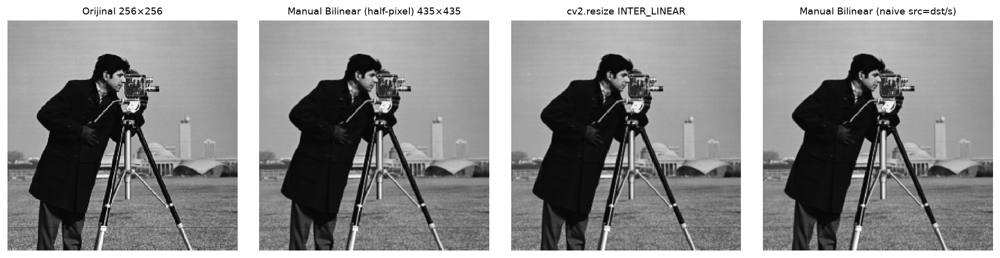

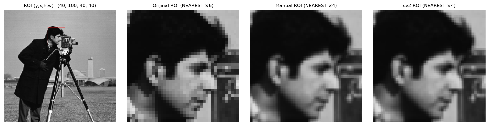

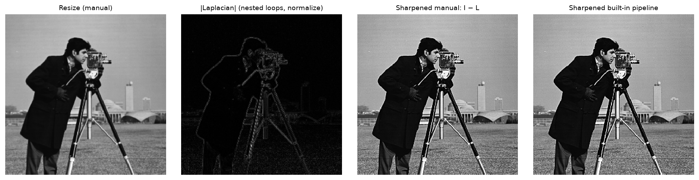

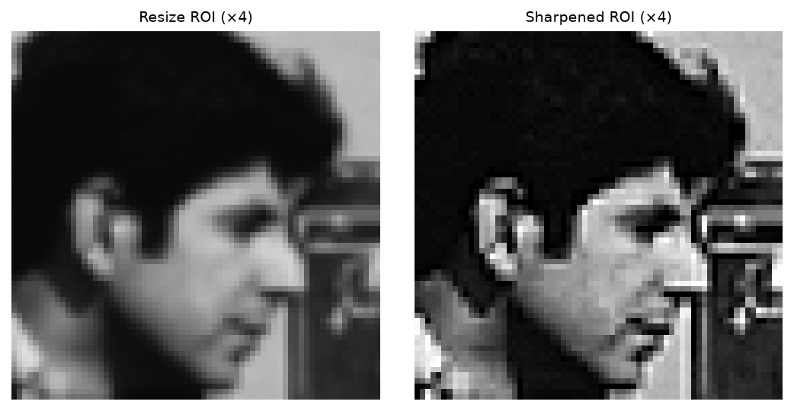

Laplacian yanıtı [-256, 241] aralığındadır (negatif piksel oranı: %42.6). Keskinleştirme sonrası clip'lenen piksel oranları: 0'ın altında %1.69, 255'in üstünde %0.50.

### 3.5 Manuel ve Built-in Karşılaştırması

Built-in referanslar: `cv2.resize(..., interpolation=cv2.INTER_LINEAR)` (aynı `dsize`), `cv2.filter2D` (aynı kernel, `float64`, `BORDER_REFLECT_101`) ve `cv2.Laplacian(ksize=1)`.

| Karşılaştırma | max abs Δ | ortalama abs Δ | PSNR (dB) | farklı piksel % |
| --- | --- | --- | --- | --- |
| Resize: manual (half-pixel) vs cv2.resize | 1 | 0.1232 | 57.23 | 12.32 |
| Resize: manual (naive) vs cv2.resize | 52 | 2.4030 | 33.31 | 61.22 |
| Laplacian: loops vs cv2.filter2D (float64) | 0 | 0.0000 | ∞ | 0.00 |
| Laplacian: loops vs cv2.Laplacian(ksize=1) | 0 | 0.0000 | ∞ | 0.00 |
| Sharpen: aynı giriş, manual vs built-in | 0 | 0.0000 | ∞ | 0.00 |
| Sharpen: tam pipeline manual vs cv2 | 6 | 0.9542 | 43.32 | 46.55 |
| Taşma: uint8 doygun L vs float L | 256 | 3.5592 | 27.18 | 42.63 |
| Taşma: uint8 wrap L vs float L | 256 | 109.1306 | 3.67 | 42.63 |

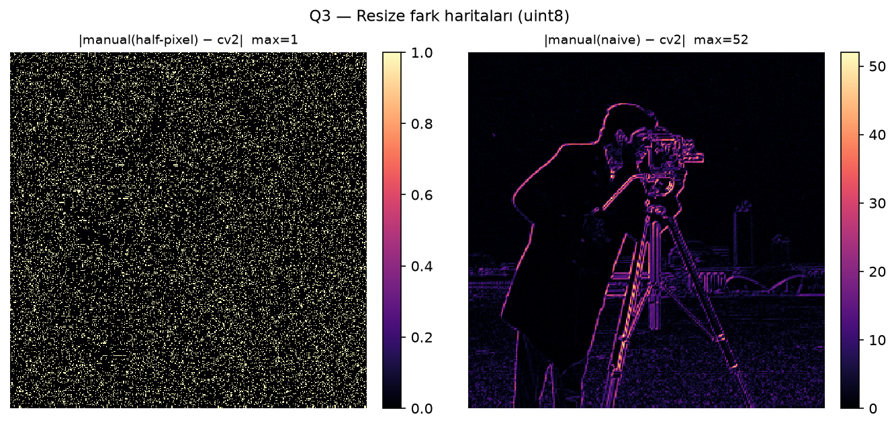

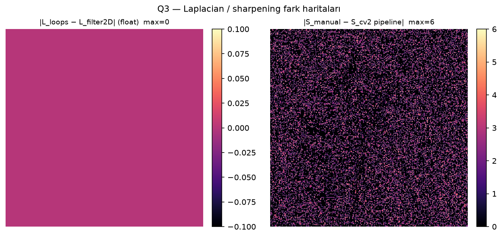

### 3.6 Farkların Nedenleri

1. **Piksel merkezi kuralı (half-pixel offset).** OpenCV kaynak konumu $s = (d + 0.5)\cdot oran - 0.5$ ile hesaplar; yani piksellerin **merkezlerini** hizalar. Naive $s = d\cdot oran$ eşlemesi ise piksel **köşelerini** hizalar ve görüntüyü sola-yukarı yaklaşık 0.5·(1 − 1/1.7) ≈ 0.21 giriş pikseli kaydırır. Naive kural ile fark: maksimum 52, ortalama 2.40, işaretli ortalama +0.075; fark haritasında (sağda) farkın nesne kenarlarında yoğunlaştığı görülür, çünkü yarım piksellik kayma yalnızca yoğunluğun değiştiği yerlerde değer farkı üretir. Half-pixel kural ile fark: maksimum 1, PSNR 57.23 dB.
2. **Yuvarlama / sabit noktalı aritmetik.** Half-pixel kuralda kalan fark (farklı piksel oranı: %12.3), OpenCV'nin `uint8` resize'da ağırlıkları 11 bitlik tamsayılara (INTER_RESIZE_COEF_BITS = 11, ölçek 2048) yuvarlayıp tamsayı aritmetiği kullanmasından kaynaklanır. Manuel sürüm ağırlıkları `float64` ile tam hesaplar ve sonucu yalnızca en sonda yuvarlar. Float manuel sonuç ile OpenCV `uint8` sonucu arasındaki maksimum fark 0.754; bu değer 1'den küçük olduğundan uint8 farkı son yuvarlama adımından kaynaklanır. İşaretli ortalama fark +0.1231, mutlak ortalama 0.1232 gri seviyedir: fark **tek yönlüdür**; farklı piksellerde manuel sonuç cv2'den 1 gri seviye yüksek. Bu, OpenCV'nin sabit noktalı ağırlık ve ara sonuç yuvarlamasındaki yanlılıktır; büyüklüğü görsel olarak önemsizdir.
3. **Border (padding) modu.** Laplacian'da manuel sürüm ve OpenCV aynı `reflect101` modunu kullandığında çıktılar **bit düzeyinde aynıdır** (maksimum fark 0). Farklı modlar yalnızca görüntünün en dış 1 piksellik çerçevesini etkiler:

| Border karşılaştırması | max abs Δ | farklı piksel | iç bölgede farklı piksel |
| --- | --- | --- | --- |
| reflect101 vs replicate | 21 | 857 | 0 |
| reflect101 vs zero | 315 | 1736 | 0 |

4. **uint8 taşması (overflow).** Laplacian negatif değerler ve 255'ten büyük değerler üretir. `uint8` çıktılı `cv2.filter2D` negatifleri 0'a **doyurur** (saturation), NumPy `uint8` aritmetiği ise mod 256 **sarar** (wrap-around). Her iki durumda da float sonuçtan büyük sapmalar oluşur (tablodaki son iki satır) ve doyurulmuş Laplacian ile yapılan keskinleştirme yanlış sonuç verir (doğru keskinleştirmeye göre maksimum fark: 134). Bu yüzden tüm hesaplar `float64` ile yapılmıştır.

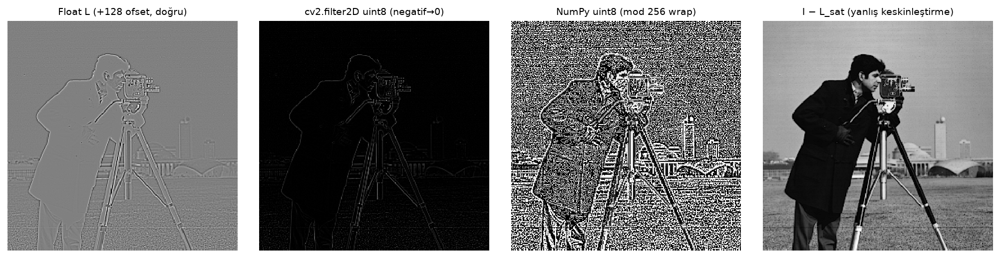

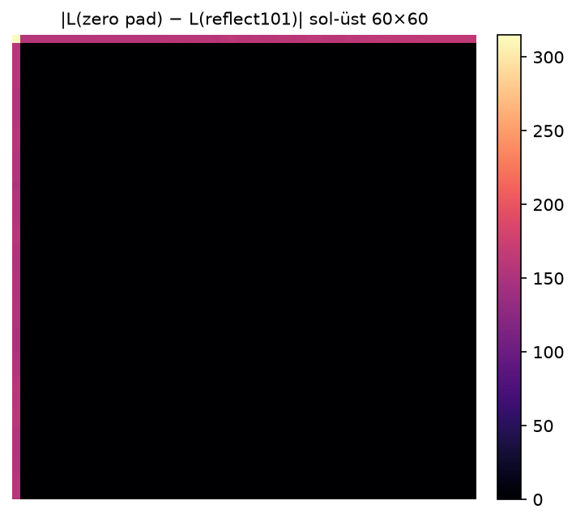

Tam pipeline'da (manuel resize → manuel Laplacian → keskinleştirme ile cv2.resize → cv2.Laplacian → keskinleştirme) kalan fark (maksimum: 6), resize adımındaki ±1 farkların keskinleştirme çekirdeğiyle (merkez katsayısı 1 + 4 = 5) büyütülmesinden kaynaklanır; aynı girişe uygulandığında keskinleştirme farkı (maksimum): 0.

---

## 4. Özet

| Soru | Ana bulgu | Kanıt |
| --- | --- | --- |
| Q1 | Manuel Contrast Stretching ve HE çıktıları her iki görüntüde tam [0, 255] aralığını kapsıyor (tire zaten tam aralıkta olduğundan stretching onda özdeşlik dönüşümü oldu); `cv2.equalizeHist` ile maksimum fark: pout 0, tire 0. Doğal gürültüde en iyi gürültü–keskinlik dengesi: Gaussian σ=1 (7×7) (pout), Gaussian σ=1 (7×7) (tire); impulsif gürültüde en iyi: Median 3×3 (pout), Median 3×3 (tire); kenarı Mean'den daha iyi koruyan: Median (her iki görüntü, 3×3 ve 5×5). | Bölüm 1.3–1.9 |
| Q2 | NN rotation'da Sobel fazla (false) kenar enerjisi %10.8, Bilinear'da %0.6; NN basamakları gradyan yönünü eksenlere kaydırıyor. | Bölüm 2.4–2.5 |
| Q3 | Half-pixel kuralıyla manuel Bilinear ile cv2.resize arasındaki maksimum fark: 1 (PSNR 57.23 dB); nested-loop Laplacian ile cv2.filter2D arasındaki maksimum fark: 0. | Bölüm 3.5–3.6 |
